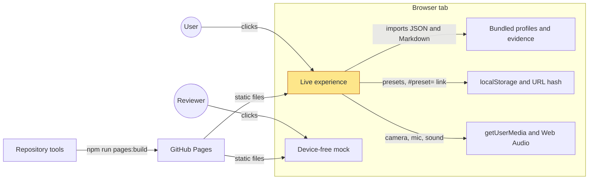
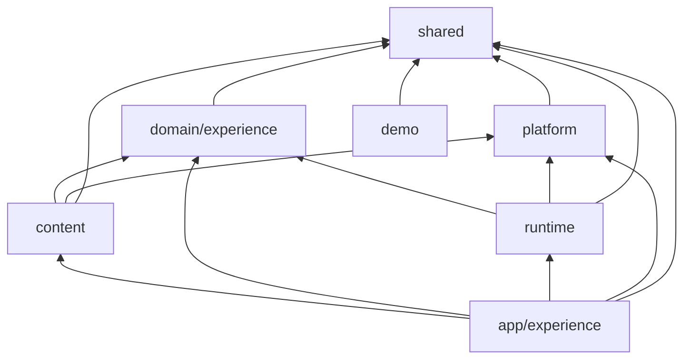
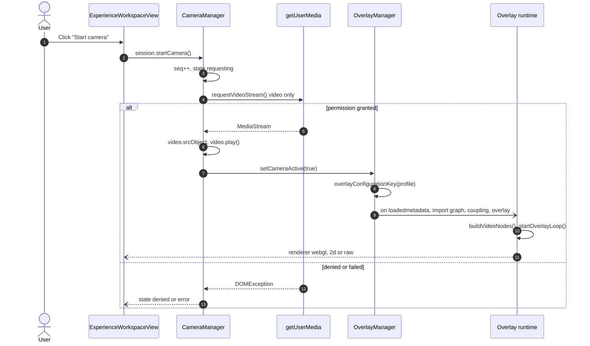
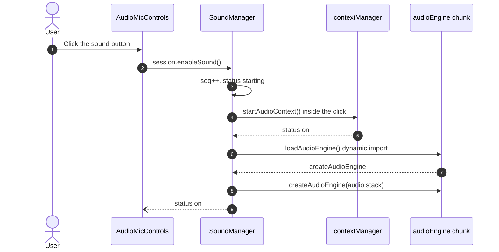
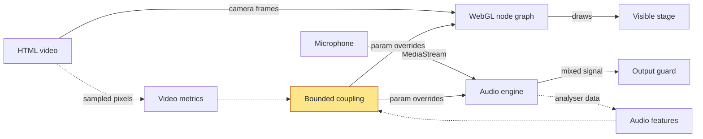
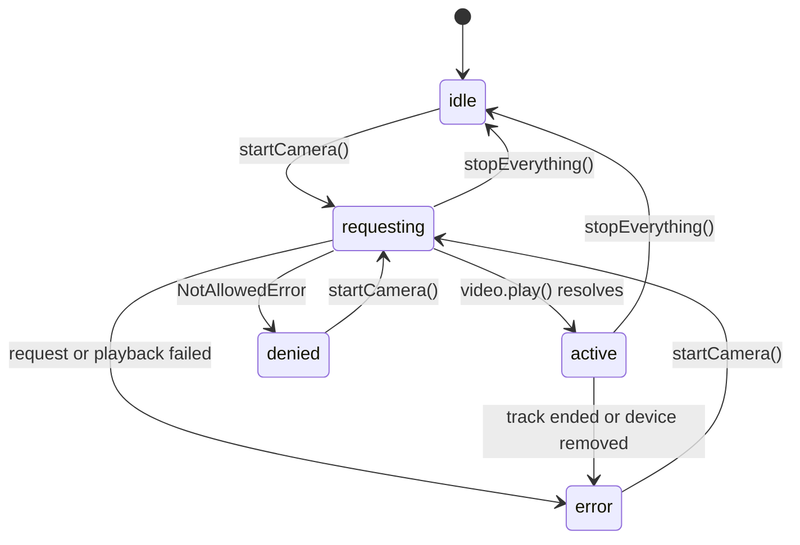
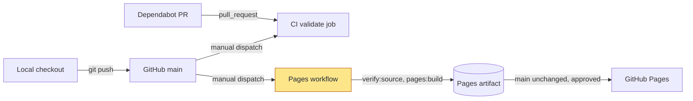

# Architecture

Inner Echo is one private npm package that builds two static browser entries: the live experience
and a device-free mock. There is no backend, service process, database, account system, or remote
application API.

New here? Read [System context](#system-context), then the two [user journeys](#user-journeys)
(Start camera and Enable sound), then [State and lifecycle ownership](#state-and-lifecycle-ownership).
Those cover what runs where and what one click reaches. The other sections go into detail.

## System context

Who uses Inner Echo, and what does it talk to?

The static host serves the app. Camera, microphone, and audio all stay inside the browser. The only
user-facing path off the origin is following an external citation in the evidence drawer; the app
never fetches citations in the background.

Where in the code:

- [index.html](../index.html) → [src/main.tsx](../src/main.tsx): live entry.
- [demo/index.html](../demo/index.html) → [src/demo/main.ts](../src/demo/main.ts): mock entry.
- [src/content/experience/loader.ts](../src/content/experience/loader.ts) and
  [src/content/evidence/documents.ts](../src/content/evidence/documents.ts): bundled profiles and
  evidence, loaded as lazy Vite chunks rather than fetched.
- [tools/deployment/build-pages.mjs](../tools/deployment/build-pages.mjs): Pages artifact.

## Entries and components

| Path | Responsibility |
| --- | --- |
| `index.html` → `src/main.tsx` | Live application bootstrap and error boundary. |
| `src/app/welcome/` | Welcome step and pre-workspace evidence access. |
| `src/app/experience/` | React composition root: visible settings, user actions, presets, and binding to the media session (see [app map](#app-layer-map)). |
| `src/domain/experience/` | Pure schemas, safety and motion policy, parameter addressing and control resolution, stack resolution, and composition. |
| `src/content/experience/` | Bundled catalog, profiles, dimensions, mappings, and validating adapters. |
| `src/content/evidence/` | Bundled Markdown lookup, parsing, and sanitization. |
| `src/runtime/session/` | The media session: the single owner of the camera stream, audio engine, microphone, and overlay lifecycle ([ADR-0004](decisions/0004-media-session-ownership.md)). |
| `src/runtime/camera/` | Video-only camera acquisition and track cleanup. |
| `src/runtime/audio/` | `AudioContext`, synth, optional microphone, effects, analysis, and disposal. |
| `src/runtime/visual/` | Video-node factories, WebGL rendering, Canvas2D fallback, metrics, and GPU cleanup. |
| `src/runtime/coupling/` | Bounded audio-to-video and video-to-audio mappings. |
| `src/platform/`, `src/shared/` | Focused diagnostics and cross-layer primitives. |
| `demo/index.html` → `src/demo/main.ts` | Semantic mock product states plus a dependency-free DOM controller, with no live device, persistence, clipboard, or network capability. |
| `tools/` | Build-time validation, documentation generation, release inspection, and Pages assembly. |

The mock entry imports no React and no production layer. `src/demo/` may import only itself and
`src/shared/`, and its current controller has no dependencies at all. Pages verification walks the
demo's static and dynamic imports and scans every JavaScript chunk in that closure for media, audio,
media-playback, persistent-storage, clipboard, and network APIs.

## Dependency direction

`domain` is browser-independent: it receives immutable capability identifiers, never constructors or
browser handles. `content` turns bundled data into validated domain values. `runtime` owns effects
and side effects. `app` combines the inward layers and owns user-facing workflow state.

`npm run architecture:check` enforces these import directions and rejects static or dynamic import
cycles. `tsconfig.domain.json` omits DOM libraries so domain and shared code cannot pick up browser
globals by accident.

## Experience data flow

1. Content adapters load bundled catalog, dimension, mapping, or profile JSON.
2. Zod schemas reject invalid data and normalize supported optional values.
3. `app/experience/profile/useProfileLoad.ts` selects a curated profile or composes one from dimensions
   or weighted collections.
4. Domain policy applies interaction, global bounds, Safe Mode, and Reduced Motion.
5. The app passes the profile and live settings to the media session. After camera metadata is
   available, the session lazily loads graph, coupling, and overlay constructors.
6. `runtime/visual/graph` creates executable video nodes from declarative `video_stack` entries.
7. The audio engine applies the desired audio stack when sound has been activated.

Persisted setup-mode values remain `symptom`, `preset`, and `multimorbid` for compatibility, while
the interface labels them Experience dimensions, Curated collections, and Combine collections.

Where in the code: [src/content/experience/loader.ts](../src/content/experience/loader.ts),
[src/app/experience/profile/useProfileLoad.ts](../src/app/experience/profile/useProfileLoad.ts),
[src/domain/experience/composition/](../src/domain/experience/composition/), and
`useSessionLiveSettings` in
[src/app/experience/workspace/useExperienceSession.ts](../src/app/experience/workspace/useExperienceSession.ts),
which calls `session.update()` whenever the profile or a live setting changes.

## User journeys

Each media control is a separate button, and each one reaches a different manager inside the media
session. The two diagrams below trace the two that start media. Before either click, the profile
has already reached the session through `session.update()` (step 5 of the data flow above).

### Start camera

What happens between clicking Start camera and seeing effects?

Every state change (steps 3, 7, 11, 13) calls the session's listeners, and the view re-reads one
immutable snapshot through `useSyncExternalStore`. The camera result is discarded if `seq` moved on
while the browser prompt was open (step 4), which is how a Stop Everything during the prompt wins.
The overlay manager starts nothing until the camera is `active`. Step 8 computes a canonical key of
everything the graph captures, so a later `session.update()` with an equivalent profile keeps the
running graph instead of rebuilding it. The Three.js graph, coupling, and overlay modules (step 9)
are separate chunks that load only now. `startOverlayLoop()` prefers WebGL and falls back to
Canvas2D, then raw video, reporting the real renderer each time (step 11).

Where in the code:

- [src/app/experience/workspace/useExperienceWorkspace.ts](../src/app/experience/workspace/useExperienceWorkspace.ts):
  `useCameraController` binds the button to `session.startCamera`.
- [src/runtime/session/session.ts](../src/runtime/session/session.ts): `createExperienceSession`
  wires camera state to `overlay.setCameraActive`.
- [src/runtime/session/camera.ts](../src/runtime/session/camera.ts) and
  [src/runtime/camera/camera.ts](../src/runtime/camera/camera.ts): `start`, `attachStream`,
  `requestVideoStream`.
- [src/runtime/session/overlay.ts](../src/runtime/session/overlay.ts): `sync`,
  `overlayConfigurationKey`, `loadOverlayModules`.
- [src/runtime/session/overlayReactive.ts](../src/runtime/session/overlayReactive.ts):
  `createReactiveOverlayLifecycle`, `startReactiveOverlay`.
- [src/runtime/visual/overlay/index.ts](../src/runtime/visual/overlay/index.ts): `startOverlayLoop`
  and the renderer fallbacks.

### Enable sound

What happens when the user turns on sound?

Step 4 creates or resumes the `AudioContext` synchronously inside the click, because browsers only
allow audio to start from a user gesture ([ADR-0001](decisions/0001-direct-user-media-activation.md)). The
engine code is fetched after that (step 6), so it never runs for users who leave sound off. If the
user stops sound while steps 4 to 7 are pending, `seq` has moved on and the late engine is stopped
instead of installed. The microphone follows the same pattern through `session.enableMic()`, and
is only offered once this engine exists.

Where in the code:
[src/runtime/session/sound.ts](../src/runtime/session/sound.ts) (`startSound`, `install`),
[src/runtime/audio/contextManager.ts](../src/runtime/audio/contextManager.ts)
(`startAudioContext`), [src/runtime/audio/loadAudioEngine.ts](../src/runtime/audio/loadAudioEngine.ts),
and [src/runtime/audio/audioEngine.ts](../src/runtime/audio/audioEngine.ts).

## Media and coupling flow

Once camera and sound run, what flows between them on each frame?

Dotted edges are sampled only when something live needs them. Activation is covered in
[User journeys](#user-journeys).

Where in the code: [src/runtime/coupling/](../src/runtime/coupling/) (`couplingEngine.ts`,
`reactiveDriver.ts`), [src/runtime/visual/overlay/videoMetrics.ts](../src/runtime/visual/overlay/videoMetrics.ts),
[src/runtime/audio/analyserFeatures.ts](../src/runtime/audio/analyserFeatures.ts), and
[src/runtime/audio/outputGuard.ts](../src/runtime/audio/outputGuard.ts).

Camera, sound, and microphone activate separately. A microphone request is only possible once the
audio graph exists. Importing a preset updates the desired configuration with audio forced off.

The WebGL frame loop reads the session's current live settings and samples metrics only when
something live needs them. Video readback runs for active coupling or development diagnostics; audio features run for
coupling or applicable legacy RMS mappings. The development RMS meter has its own activation gate.
Changing those controls takes effect without restarting the overlay. Withdrawing audio overrides or
stopping the overlay restores each affected audio module's original parameters, including defaults
omitted from legacy presets. Schema ranges, profile policy, user controls, Safe Mode, Reduced
Motion, and engine clamps all constrain coupling.

The audio session compares canonical stack values before scheduling a switch, so an equivalent
profile update preserves oscillators, buffers, and the existing effects chain. One retained output
guard follows the master gain and all mixed sources, independently of the optional profile chain.
Its non-oversampled WaveShaper curve keeps quiet samples linear and smoothly bounds per-channel
digital samples below the global -6 dBFS ceiling. Profile compressor ceilings are attenuation
settings, not additional hard output limits. This digital bound does not guarantee reconstructed
true peak or acoustic volume at the listener's device.

## State and lifecycle ownership

React owns the user's choices: composition, comfort settings, presets, evidence, and debug toggles.
The media session in `src/runtime/session/` owns every long-lived browser resource and publishes an
immutable snapshot that React reads with `useSyncExternalStore`. User actions call session methods
directly, so direct-activation rules hold inside the click. The public state contracts are:

- camera: `idle`, `requesting`, `active`, `denied`, or `error`;
- sound: `off`, `starting`, `on`, or `error`;
- microphone: `off`, `requesting`, `on`, `denied`, or `error`;
- overlay: renderer `webgl`, `2d`, `raw`, or `unavailable`, plus `effectsActive` and an optional error;
- profile and catalog loading: explicit loading, ready, and error states.

Interruptions and browser blocks surface through the applicable error state and message, not as
separate public union members. Visible state follows real runtime transitions; clicking a control
never optimistically claims capability.

Which states can the camera be in, and what moves it between them?

The overlay follows this machine: it runs only while the camera is `active`, and leaving `active`
for any reason disposes it. Sound and microphone have their own machines in
[src/runtime/session/sound.ts](../src/runtime/session/sound.ts); a camera error never changes them.
Health monitoring (a 250 ms track poll plus `devicechange`) runs only in `active`. See
[src/runtime/session/camera.ts](../src/runtime/session/camera.ts) (`setState`, `interrupt`,
`monitorActiveStream`).

The session is created once per workspace. Its browser services are injected, so tests replace
them without mocking module paths. Request-sequence guards discard stale async results. Stop Everything invalidates pending camera and
audio work, then stops the overlay, audio graph, microphone tracks, camera tracks, video bindings,
and canvases before returning the UI to idle. A camera interruption tears down the camera and
overlay but does not silently stop independently activated audio.

## Rendering and bundle boundaries

WebGL is preferred only after renderer startup succeeds. A startup or fatal runtime failure falls
back to Canvas2D passthrough; if no safe canvas remains, the app reports the raw video or an
unavailable state. Fallbacks never claim active WebGL effects.

The welcome entry mounts the workspace only after acknowledgement, and evidence stays available
through the sanitized lazy drawer before Continue. The direct sound action creates or resumes the
audio context before asynchronously loading engine construction, and sequence guards prevent stopped
or superseded requests from installing an engine. The graph and Three.js constructors load after the
camera becomes usable. `npm run bundle:verify` enforces these loading boundaries and keeps
development-only diagnostics out of production chunks.

When a profile changes, the overlay lifecycle compares a canonical identity of video definitions,
audio-chain definitions, reactive mappings, safety policy, and Reduced Motion. Equivalent profiles
keep the graph and coupling state while the session applies the current live values. Camera restart and explicit profile retry remain restart triggers.

The frame loop renders the effect chain into one cover-fitted source target plus a two-target
ping-pong pair; only temporal nodes own an extra pair, kept in half-float precision where the
context can render to it (8-bit history is dithered instead, so a feedback blend cannot leave a
ghost stuck at the quantisation floor). The chain runs at backing-store resolution (CSS size times
the DPR, capped at 2) under a pixel budget, and the adaptive render scale lowers it further when
frame time drops. Internal targets are reallocated only once a resize has settled; the canvas size
follows the container immediately. The camera texture is uploaded and the source pass rendered
only when the video reports a new frame, and the last non-temporal node draws straight to the
screen when the chain already matches the drawing-buffer size. GPU error polling is periodic
rather than per frame.

Vite emits `index.html` and `demo/index.html` without source maps and includes the public notice
files. The Pages assembler applies the configured base path, adds `.nojekyll`, and injects the
document-level CSP fallback before load-bearing elements in every HTML entry. See
[RELEASING.md](RELEASING.md) and [../SECURITY.md](../SECURITY.md).

## Build and release

How does a commit become the live site?

`npm run verify` is the gate locally and in the CI job: type-check and `vite build`, bundle-boundary
and notice checks, `verify:source` (generated docs, links, lint, architecture, content, contracts,
audio), then the tests. The Vitest suite is kept out of the public repository, so `npm test` skips
it in public clones and in CI. CI adds the dependency audit and the Pages build, and runs only on
manual dispatch or a Dependabot pull request; a push alone runs nothing. The Pages workflow runs
the same checks in its own order, refuses to deploy if `main` moved during the build or while
awaiting environment approval, and only then publishes. Tags and release notes are manual steps in
[RELEASING.md](RELEASING.md).

Where in the code: [package.json](../package.json) (`verify`, `verify:source`, `pages:*`),
[.github/workflows/ci.yml](../.github/workflows/ci.yml),
[.github/workflows/pages.yml](../.github/workflows/pages.yml), and
[tools/deployment/](../tools/deployment/).

## App layer map

| Path under `src/app/experience/` | Responsibility |
| --- | --- |
| `ExperienceWorkspace.tsx` | Lazy workspace entry; its path is a checked bundle boundary. |
| `workspace/` | Workspace model, view shell, settings object, session binding, and shared labels. |
| `media/` | Camera, comfort, sound, and microphone controls, plus media status copy. |
| `composer/` | Composition UI, selection helpers, framing, and composition report. |
| `profile/` | Catalog and profile loading and composition, badge strengths, and control-resolution wrapper. |
| `presets/` | Persisted preset format and `#preset=` grammar, storage and migration, and the library hook and panel. |
| `evidence/` | Sanitized lazy evidence drawer. |
| `debug/` | Development-only diagnostics panel and formatting. |
| `ui/` | Shared form primitives. |

## Extension points and invariants

- Add pure experience policy to `domain`, bundled definitions to `content`, device or constructor
  behavior to `runtime`, and workflow composition to `app`. The app reaches media only through
  `src/runtime/session/`, and it never holds streams, audio contexts, or request counters.
- Keep runtime subsystem imports behind narrow `index.ts` or graph facades.
- Treat schemas, profiles, mappings, graph builders, registries, safety policy, and generated
  references as one contract.
- Keep registry metadata introspection-only; runtime builders remain the executable authority.
- Never add passive media activation, unbounded coupling, unsanitized evidence HTML, production
  stress controls, or device capability to the mock entry.

Accepted rationale and rollback triggers are recorded in [decisions/](decisions/README.md).
